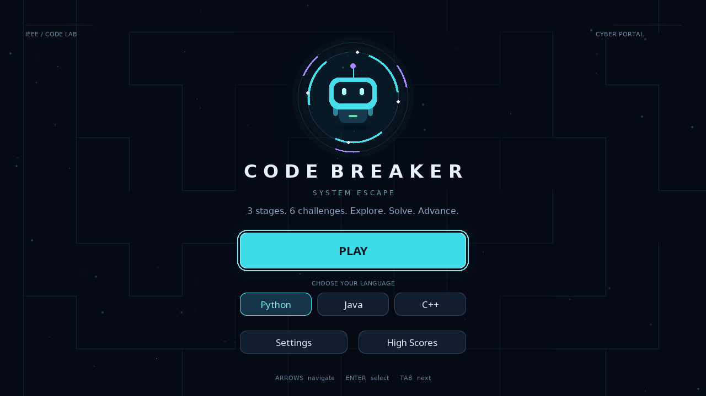

# CODE BREAKER: CYBER PORTAL

A 2D programming maze game built with **Python**, **pygame-ce**, and **pygame_gui**. Explore randomized mazes, repair code, and earn speed bonuses across progressively harder stages.

Created for an **IEEE event**, the game combines maze exploration with hands-on programming challenges. You control **BYTE**, a small robot restoring a damaged digital system.



## Features

- **Three stages and six challenges** with increasing difficulty.
- **Randomized 13 × 9 mazes** with challenge locations spread across different areas, away from the starting corner.
- **Two challenge types:** Debugging and Complete Code.
- **Three programming languages:** Python, Java, and C++.
- A code editor with line numbers, syntax colors, expected output, actual output, and error feedback.
- **Speed bonuses**, collectible energy, and a short dash ability.
- Animated menus, stage transitions, sound controls, and a pause screen.
- **Local JSON high scores**, keeping one best result per player name.

## How to play

1. Choose your language and press **PLAY**.
2. Explore the maze and find the first numbered challenge.
3. Fix the code or complete its missing line. Use **Run** to experiment and **Submit** to check your answer.
4. Move to the next challenge in another part of the maze.
5. Solving the last challenge automatically starts the next stage after a short transition.
6. Complete all three stages to win, then enter your name to save your score.

Each stage has **120 seconds**. You start with **three hearts**, which carry over between stages. An incorrect submission costs one heart; running code is free. Running out of time or hearts ends the campaign.

Challenge gates must be solved in number order. You do **not** need to return to the starting point or reach an exit to finish a stage.

## Challenge progression

| Stage | Theme | Programming concepts |
| --- | --- | --- |
| 1 | Boot Sequence | Arithmetic and indexing |
| 2 | Control Flow | Loop bounds and accumulation |
| 3 | Core Recovery | Functions with conditions and nested loops |

Numeric values vary between games to provide different versions of the challenges.

## Requirements

- Python 3 with `pip` and `venv` support. Development tests used Python 3.12.
- `pygame-ce==2.5.8`
- `pygame_gui==0.6.14`
- A display resolution of **1280 × 720 or higher** is recommended.

Optional language tools:

| Challenge language | Required tool |
| --- | --- |
| Python | The Python interpreter running the game |
| C++ | `g++` available in `PATH` |
| Java | A JDK with both `javac` and `java` available in `PATH` |

Python and C++ were tested during development. Java still needs verification on the target event computer.

## Installation

Download or clone the repository, then open a terminal in the folder containing `main.py` and `requirements.txt`.

### Linux / macOS

```bash
bash setup.sh
bash start.sh
```

The setup script creates a separate `.venv_portal` environment and installs the required packages. Run setup once; use `bash start.sh` for later sessions.

### Windows

Run `setup.bat` once, then run `start.bat` to launch the game.

An internet connection is needed to install dependencies. The game runs locally afterward.

## Controls

| Context | Key / action | Effect |
| --- | --- | --- |
| Menus | Arrow keys | Navigate; left/right changes language in the language row |
| Menus | `Enter` | Activate the selected control |
| Menus | `Tab` / `Shift+Tab` | Move between controls |
| Menus | `Esc` | Go back |
| Maze | `WASD` / arrow keys | Move BYTE |
| Maze | `Space` | Dash, with a two-second recharge |
| Maze | `E` | Open a nearby available challenge |
| Maze | `P` / `Esc` | Pause |
| Editor | `F5` | Run the code without losing a heart |
| Editor | `F6` | Submit the solution |
| Editor | `F1` | Show a hint |
| Editor | `Ctrl+R` | Reset the code |
| Editor | `Esc` / Back | Return to the maze |
| Editor | Mouse wheel | Scroll output and errors |
| Display | `F11` | Toggle fullscreen |

The mouse can also activate interface buttons. Challenges open automatically when BYTE approaches an available gate while moving. Use the **PAUSE** button to pause from the editor when no code run is pending.

## Scoring

| Action | Points |
| --- | --- |
| Solve a challenge | +100 |
| Solve without using a hint | +25 |
| Speed bonus | +0 to +100 per challenge |
| Collect an energy crystal | +10 |
| Complete a stage | Remaining whole seconds added as points |

The speed bonus is calculated as:

```text
max(0, 100 - floor(2 × solve_seconds))
```

For example, a solution in **10 seconds** earns **80 speed points**; a solution in **30 seconds** earns **40**. The timer starts when a challenge is first opened. Pausing and code execution/compilation time are excluded. Closing and reopening a challenge does not reset its timer or restore the no-hint bonus.

## High scores and JSON storage

The game automatically creates:

```text
data/dashboard.json
```

Results are saved after the player enters a name and selects **SAVE SCORE**. The file stores up to **30 ranked player records**, including points, time, accuracy, language, campaign statistics, speed bonuses, and a UTC save timestamp.

- Player names are matched without case differences or extra whitespace: `Ahmed` and ` ahmed ` share one record.
- A better result updates that record. A lower or equal result does not create a duplicate or rewrite the file.
- Ranking uses **score**, then **accuracy**, then **shorter time**.
- Existing duplicate names are merged when the file is loaded.
- Legacy scores are imported from `~/.code_breaker_ieee/scores.json` when the new file is first created.
- Writes replace the previous file only after the new JSON is fully written. Invalid JSON is not silently overwritten.

The `.gitignore` excludes player results and temporary save files. Keep `data/dashboard.json` when moving or updating your local installation.

## Project structure

| File | Purpose |
| --- | --- |
| `main.py` | Application entry point and event loop |
| `campaign.py` | Stages, progression, and gameplay interface |
| `campaign_questions.py` | Six challenge concepts and their variants |
| `challenge_placement.py` | Distributed, reachable challenge locations |
| `mazegenerator.py` | Random maze generation |
| `portal_ui.py` | Animated menus and pygame_gui controls |
| `game.py` / `engine.py` | Shared game logic and editor behavior |
| `runner.py` | Local code execution and output capture |
| `scoring.py` | Speed-bonus calculation |
| `score_store.py` | JSON persistence and unique-name handling |
| `assets/theme.json` | Interface theme |

## Tests

After setup, run:

```bash
.venv_portal/bin/python test_score_store.py
.venv_portal/bin/python test_speed_scores.py
.venv_portal/bin/python test_game.py
.venv_portal/bin/python test_portal.py
.venv_portal/bin/python test_campaign.py
```

On Windows, replace `.venv_portal/bin/python` with `.venv_portal\Scripts\python.exe`.

Tests cover scoring, duplicate names, JSON persistence, interface interactions, challenge execution, and progression through distributed maze locations. They use temporary score folders and a headless SDL display. Sound and fullscreen should also be checked on the event machine.

## Execution model

Solutions are evaluated by comparing actual program output with reference output for the challenge's generated values. This is not a hidden multi-input test platform.

Code runs in a separate process with time limits, output limits, and operation restrictions. The runner is intended for supervised local use; it is **not a security sandbox for a public code-execution service**.
