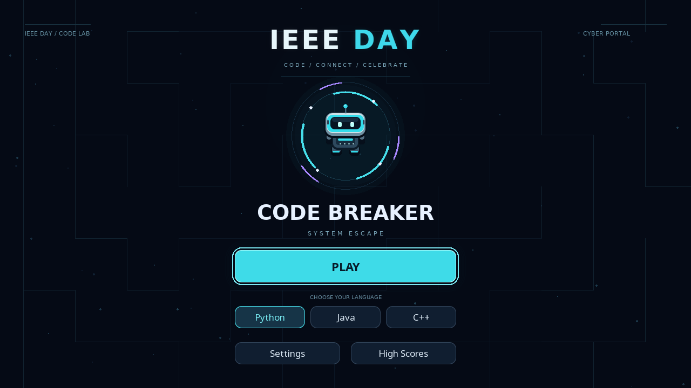

# CODE BREAKER — IEEE DAY Edition

### Explore. Decode. Escape.

A programming maze game created for **IEEE DAY**. Explore a cyber-themed maze, repair code, and restore the system through three stages of increasingly challenging puzzles.

Built with **Python**, **pygame-ce**, and **pygame_gui**, with coding challenges in **Python, C++, and Java**.



## Highlights

- **Three stages, six challenges:** solve two numbered gates in each stage to advance.
- **Increasing difficulty:** start with basic expressions and finish with functions and nested loops.
- **Fresh rounds:** questions and inputs rotate between games, with history retained across restarts.
- **Three challenge languages:** Python, C++, and Java.
- **Interactive code editor:** syntax colors, mouse selection, clipboard shortcuts, indentation, and persistent drafts within a round.
- **Animated presentation:** detailed robot sprites, metallic maze materials, energy crystals, gate effects, and wall-occluded player lighting.
- **IEEE DAY identity:** a clean event-themed menu and dedicated branding in the gameplay header.
- **Local leaderboard:** one best result per player name.
- **Admin preview:** inspect stages and challenges without completing the campaign.
- **Protected code execution:** compilation and execution use the project's Linux isolation backend.

## Gameplay

1. Choose a language from the main menu.
2. Open **Settings** to choose **Debugging** or **Complete Code**.
3. Select **PLAY** and explore the maze.
4. Reach the first numbered gate and solve its challenge.
5. Find and solve the second gate to complete the stage.
6. Restore all three stages to finish the campaign.

Each stage starts with **120 seconds**. You begin with **three hearts**, and your remaining hearts carry over between stages. A wrong submission costs one heart; running code without submitting does not. Running out of time or hearts ends the campaign.

Stage progression is automatic after both gates are solved. You do not need to return to the starting point or find a separate exit.

### Difficulty progression

| Stage | Theme | Typical concepts |
| --- | --- | --- |
| 1 | Boot Sequence | Arithmetic, strings, indexing, comparisons, unit conversion |
| 2 | Control Flow | Loop bounds, accumulation, filtered counting, filtered sums |
| 3 | Core Recovery | Functions, conditions, positive transformations, nested loops |

The question bank contains **13 task types**. Each campaign selects six, distributed across the three difficulty tiers. Reopening a challenge or resetting its starter code keeps the same question for that round. Concepts may reappear in later rounds.

### Challenge modes

| Mode | Goal |
| --- | --- |
| Debugging | Find and fix the incorrect code. |
| Complete Code | Replace the missing line with a working solution. |
| Predict Output | Select the expected result of a code snippet. |

The underlying engine and verification tools support all three modes. The current campaign Settings screen exposes **Debugging** and **Complete Code**.

## Requirements

The protected desktop launcher targets **Linux, primarily Fedora**, running as a regular desktop user.

Required components:

- Python 3 with virtual environment and pip support.
- `pygame-ce==2.5.8` and `pygame_gui==0.6.14`.
- `g++` and the BFD linker (`ld.bfd`) for C++ challenges.
- A JDK providing `java` and a working Java compiler for Java challenges.
- Bubblewrap, libseccomp, and the namespace support required by the isolation backend.
- systemd user services with delegated cgroup v2 CPU, memory, and process controllers.

An internet connection is needed to install Python dependencies. Normal gameplay and scores are local.

The repository includes legacy Windows launchers, but they do **not** provide an equivalent supported protected-execution setup. See [LOCAL_SETUP.md](LOCAL_SETUP.md) and [SECURITY.md](SECURITY.md) for the current platform requirements.

## Setup and launch

Open a normal Fedora desktop terminal in the game directory:

```bash
cd /path/to/CODE_BREAKER_IEEE
bash setup.sh
bash local.sh doctor
bash local.sh verify
bash start.sh
```

- `setup.sh` installs the Python dependencies into `.venv_portal`.
- `doctor` checks the local session, toolchains, and isolation prerequisites.
- `verify` tests the protected reference, Run, and Submit flows for all three languages and challenge modes.
- `start.sh` launches the game through the same protected local launcher.

Run the game as your regular user, **not with sudo**. If you are using a coding agent with a restricted execution environment, local verification may need to run in your normal desktop terminal.

A successful verification prints nine `PASS` entries and writes `local-verification.json`. A diagnostic result such as `local_session_ready: true` is a preliminary check, not a substitute for full verification.

## Controls

| Key or action | Function |
| --- | --- |
| WASD / arrow keys | Move through the maze |
| Space | Dash |
| E | Open a nearby available challenge |
| P / Esc in the maze | Pause |
| F5 | Run code without submitting |
| F6 | Submit the current solution |
| F1 | Show a hint |
| Esc in the editor | Return to the maze |
| Ctrl+C / Ctrl+V / Ctrl+X | Copy / paste / cut |
| Ctrl+A | Select all code |
| Mouse click / drag | Position the caret / select text |
| Mouse wheel | Scroll supported editor or output areas |
| F11 | Toggle fullscreen |
| F3 | Toggle reduced motion for the added visual effects |

Available gates can also open automatically when approached during movement. Use the on-screen **RESET** button to restore starter code. Keyboard navigation and mouse interaction are supported in the menus.

## Admin preview

Admin preview is a **local development shortcut**, not an authenticated administrator account. Its shortcut list is deliberately kept off the game interface.

| Key | Function |
| --- | --- |
| F10 | Enable or disable Admin preview in place |
| Page Down / Page Up | Load the next / previous stage; navigation wraps around |
| F7 / F8 | Open the first / second challenge of the current stage |
| F9 | Preview stage completion |
| F4 | Preview the gate activation effect at the player position |

**F10 does not restart the stage.** It preserves the current maze, player position, questions, progress, hearts, score, editor draft, and any pending code execution. Only a short `ADMIN ENABLED` or `ADMIN DISABLED` notification appears. In the main menu, enabling Admin does not start a game; select PLAY when ready.

While Admin is active, the gameplay and solve-time counters are paused. Preview rounds cannot save leaderboard scores. After disabling Admin, start a fresh normal game to regain leaderboard eligibility.

Explicit stage and challenge jumps remain unavailable while code is running. Previewed challenges still use the same protected runner.

## Scoring and saved data

| Action | Reward |
| --- | --- |
| Correct solution | 100 points |
| Solve without a hint | 25 bonus points |
| Solve quickly | Up to 100 speed bonus points |
| Collect an energy crystal | 10 points |
| Complete a stage | Remaining stage time added to the score |

The speed bonus decreases by two points per second of active solve time, down to zero. It starts when a challenge is first opened. Closing and reopening the editor does not reset it; pausing and code execution do not consume solve time.

At the end of a normal campaign, enter a player name to save the result. Names are limited to 16 characters. The leaderboard keeps one best result per normalized name, ranking by score, then accuracy, then completion time.

| File | Purpose |
| --- | --- |
| `data/dashboard.json` | Local player leaderboard |
| `data/question_history.json` | Previous-round question history |
| `local-verification.json` | Latest local protected-execution verification report |

Keep your existing `data` directory when updating an installation if you want to retain its local history.

## Execution safety

Player code runs through the isolated backend rather than directly with the desktop application's unrestricted permissions. The design restricts filesystem access and networking, uses disposable job storage, and applies execution, output, memory, and process limits.

The runner **fails closed** if required isolation checks fail. Source-code restrictions alone are not a secure sandbox. See [SECURITY.md](SECURITY.md) for the implementation, assumptions, and remaining limitations.

## Verification

Run the full project checks through the protected local launcher:

```bash
bash local.sh test
```

For focused headless UI and Admin-state regression checks, use the project environment:

```bash
.venv_portal/bin/python test_visual_preview.py
.venv_portal/bin/python test_admin_state.py
.venv_portal/bin/python test_score_store.py
```

The UI checks mock reference execution where needed. They do not replace `bash local.sh verify` for real Python, C++, and Java execution.

## Project layout

| File or directory | Responsibility |
| --- | --- |
| `main.py` | Application entry point |
| `campaign.py` | Campaign progression, challenges, and gameplay screens |
| `game.py` / `engine.py` | Core game behavior and interaction |
| `campaign_questions.py` | Tiered question generation and round rotation |
| `portal_ui.py` | Menu, settings, leaderboard, and GUI controls |
| `editor_support.py` | Editor selection, caret, clipboard, and scrolling |
| `scene_art.py` / `assets/art/` | Maze materials, lighting, and robot artwork |
| `event_mark.py` | IEEE DAY event identity |
| `visual_preview.py` | Visual effects and local Admin preview |
| `runner.py` / `execution_isolation.py` | Protected language execution |
| `local_runtime.py` / `local.sh` | Local session diagnostics, verification, and launch |
| `score_store.py` / `scoring.py` | Persistent results and scoring rules |

---

**Created for IEEE DAY — Code. Connect. Celebrate.**
